# AD DS and Microsoft Entra ID Hybrid Identity Lab — Technical Documentation

This document records the design, implementation, verification and troubleshooting of the lab's on-premises Active Directory environment and its integration with Microsoft Entra ID using Microsoft Entra Cloud Sync. It is intended to be read alongside the repository's [main README](../README.md).

## Project Scope and Current Status

The completed work documented here establishes a **functional hybrid identity environment**: an on-premises Active Directory Domain Services (AD DS) forest, DNS, one domain controller (`LAB-DC01`), a Windows 11 client (`LAB-WS01`) joined to the domain, and directory and device synchronization to Microsoft Entra ID (`hybridlab.onmicrosoft.com`) via **Microsoft Entra Cloud Sync**, culminating in a validated **Microsoft Entra Hybrid Join** for `LAB-WS01`.

The on-premises lab uses `corp.hybridlab.test` as its forest-root domain. The `.test` top-level domain is reserved for testing and is suitable for an isolated lab; it is not a publicly registered production domain ([IANA: .test](https://www.iana.org/domains/root/db/test)). Because `.test` is non-routable on the public Internet, `hybridlab.onmicrosoft.com` was added as an alternative UPN suffix in AD DS so synchronized accounts match the verified Entra tenant domain.

**Lab Approach & Sanitization Note:** This is a hands-on learning and portfolio lab designed to practice core identity administration and hybrid cloud integration. All virtual machines, directory services, cloud configurations and verification checks were deployed and validated directly in the local environment. During the Microsoft Entra ID troubleshooting phase, AI assistance was used as a diagnostic aid to interpret provisioning logs and build targeted PowerShell and Microsoft Graph queries, with every command executed and verified against live lab outputs. For security and privacy, personal details, tenant/object GUIDs and the original tenant domain name have been redacted from screenshots and replaced with generic placeholders in this documentation.

## Contents

- [Project Scope and Current Status](#project-scope-and-current-status)
- [1. Hyper-V Environment Design and Setup](#1-hyper-v-environment-design-and-setup)
- [2. Windows Server 2025 and Active Directory Domain Services](#2-windows-server-2025-and-active-directory-domain-services)
- [3. Windows 11 Domain Join and Validation](#3-windows-11-domain-join-and-validation)
- [4. Microsoft Entra ID Integration and Hybrid Join](#4-microsoft-entra-id-integration-and-hybrid-join)
- [5. Troubleshooting and Validation Results](#5-troubleshooting-and-validation-results)
- [References](#references)

---

## 1. Hyper-V Environment Design and Setup

### Objective

Set up a local virtualization environment with two Windows virtual machines connected to a controlled lab network:

- **LAB-DC01:** Windows Server 2025 Standard Evaluation (Desktop Experience), which hosts AD DS, DNS and the Microsoft Entra Connect Provisioning Agent.
- **LAB-WS01:** Windows 11 Enterprise Evaluation, version 26H2 (OS build `26300.9457`), which acts as the domain client workstation.

**01 — Hyper-V Manager: virtual machines**

The Hyper-V Manager overview shows both lab VMs registered on the host. The physical host computer's name has been hidden.

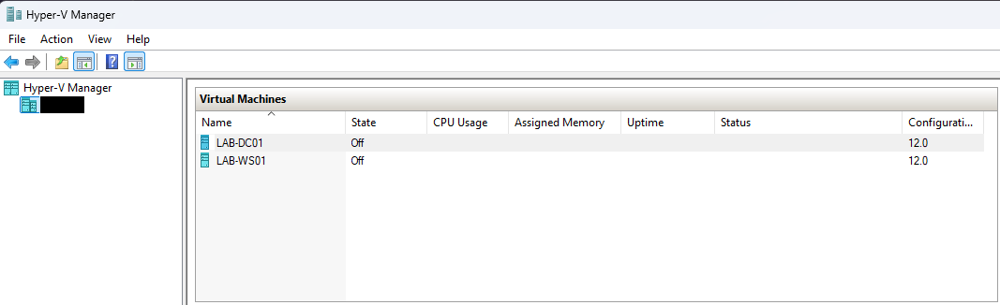

### Virtual Network

The **LAB-AD** virtual switch was configured as **Internal**. NAT was added separately to allow devices on the lab subnet to access external networks through the host.

| Item | Configuration |
|---|---|
| Virtual Switch | `LAB-AD` |
| Switch Type | `Internal` |
| Subnet | `192.168.50.0/24` |
| Host Virtual Adapter / Gateway | `192.168.50.1` |
| NAT Name | `LAB-AD-NAT` |
| LAB-DC01 | `192.168.50.10` |
| LAB-WS01 | `192.168.50.20` |

The `192.168.50.x` addresses are private IPv4 addresses used inside this lab; they are not public IP addresses assigned to the physical computer.

Hyper-V provides three virtual switch types:

- **External:** connects virtual machines to a physical network through the host's network adapter.
- **Internal — selected:** allows communication between the host computer and the virtual machines.
- **Private:** allows communication only between virtual machines.

NAT is a separate configuration layered on the internal network. It provides outbound access to external networks without changing the switch type to External.

**02 — Virtual Switch Manager: LAB-AD**

The screenshot shows `LAB-AD` selected as an Internal virtual switch. The host name and MAC address range have been hidden because they are not needed for this evidence.

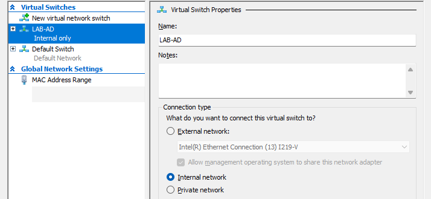

### Virtual Machines

Both virtual machines were created as **Generation 2** VMs. Each was assigned 6 GB of RAM, 2 virtual CPUs and an 80 GB dynamically expanding VHDX disk. The 80 GB value is the virtual disk's maximum capacity; the dynamically expanding format was selected to conserve space on the lab host. Both VMs are connected to `LAB-AD`.

| Setting | LAB-DC01 | LAB-WS01 |
|---|---:|---:|
| Generation | 2 | 2 |
| RAM | 6 GB | 6 GB |
| vCPU | 2 | 2 |
| Virtual Disk | 80 GB | 80 GB |
| Network | `LAB-AD` | `LAB-AD` |
| Secure Boot | Enabled | Enabled |
| Virtual TPM | Not required for this scenario | Enabled |

**03 — Virtual machine configuration: PowerShell**

Actual PowerShell output showing the generation, memory, virtual processors and virtual switch assigned to each VM.

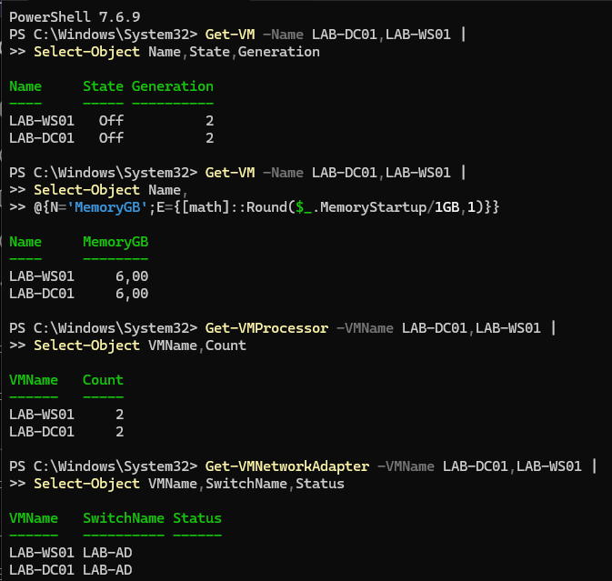

### Verification

PowerShell was used to check each VM's generation, memory, CPU allocation and network connection (`Get-VM`, `Get-VMProcessor` and `Get-VMNetworkAdapter`). The virtual switch type, the host's virtual network adapter address and the NAT status were also checked (`Get-VMSwitch`, `Get-NetIPAddress` and `Get-NetNat`).

**04 — Virtual network and NAT: PowerShell**

Actual PowerShell output showing the switch type, the host virtual adapter's IP address (`192.168.50.1/24`) and the NAT status.

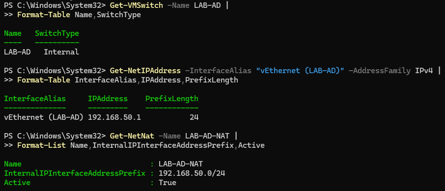

**Result:** The Hyper-V environment is ready. Both virtual machines are connected to `LAB-AD`, and the NAT configuration was verified as active.

---

## 2. Windows Server 2025 and Active Directory Domain Services

### Objective

Deploy `LAB-DC01` as the first domain controller in a new AD DS forest, configure DNS, and verify that the domain controller and its core services are operating correctly.

### Server Configuration

Windows Server 2025 Standard Evaluation (Desktop Experience) was installed on `LAB-DC01`. Before promotion, its hostname and static network configuration were set as follows:

| Setting | Configuration |
|---|---|
| Computer Name | `LAB-DC01` |
| IPv4 Address | `192.168.50.10/24` |
| Default Gateway | `192.168.50.1` |
| Preferred DNS Server | `192.168.50.10` |

The server uses the `LAB-AD` internal network created in Section 1.

### Installing the AD DS and DNS Roles

The Active Directory Domain Services and DNS Server roles were installed together with their management tools:

```powershell
Install-WindowsFeature -Name AD-Domain-Services,DNS -IncludeManagementTools
```

The installation was checked with `Get-WindowsFeature`. Both roles returned the `Installed` state. Server Manager also showed the AD DS and DNS role tiles with a healthy manageability status.

**05 — Server Manager: installed roles**

The Server Manager dashboard shows the AD DS and DNS roles installed and their manageability status.

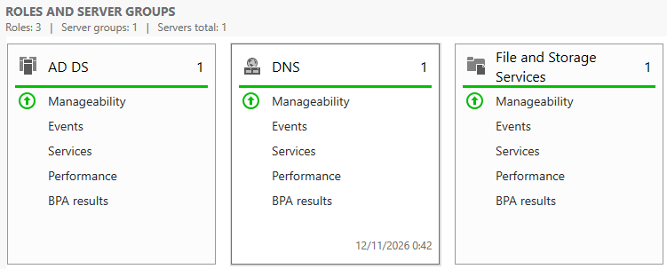

**06 — PowerShell: role installation verification**

The `Get-WindowsFeature` output confirms that both AD DS and DNS are installed.

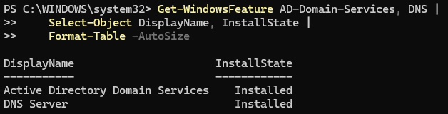

### Creating the Forest and Promoting the Domain Controller

Using the AD DS Configuration Wizard in Server Manager, the deployment operation **Add a new forest** was selected and the following root domain name was entered:

`corp.hybridlab.test`

The domain controller configuration was:

| Option | Selected configuration |
|---|---|
| NetBIOS Domain Name | `CORP` |
| Forest Functional Level | Windows Server 2016 |
| Domain Functional Level | Windows Server 2016 |
| DNS Server | Enabled |
| Global Catalog (GC) | Enabled |
| Read Only Domain Controller (RODC) | Disabled |
| DNS Delegation | Not created |
| AD DS Database and Log Files | `C:\Windows\NTDS` |
| SYSVOL | `C:\Windows\SYSVOL` |

Windows Server 2016 functional levels were selected as a compatibility baseline. At this level, Microsoft supports Windows Server 2016, 2019, 2022 and 2025 domain controllers. The Windows Server 2025 functional level supports Windows Server 2025 domain controllers only and enables newer capabilities, including the optional 32-KB Active Directory database page feature. This lab prioritizes compatibility with earlier domain controller versions over those 2025-specific functional-level capabilities. Functional levels govern domain controller compatibility and AD DS features; they do not restrict which Windows versions can join the domain ([Microsoft Learn: AD DS functional levels](https://learn.microsoft.com/en-us/windows-server/identity/ad-ds/active-directory-functional-levels)).

A separate Directory Services Restore Mode (DSRM) password was configured during the wizard. No password is recorded in this repository. The DNS delegation warning and why no delegation was created are explained in [Section 5.3](#53-dns-delegation-warning-during-forest-creation).

**07a — AD DS Configuration Wizard: new forest**

The wizard shows **Add a new forest** selected and `corp.hybridlab.test` entered as the root domain name.

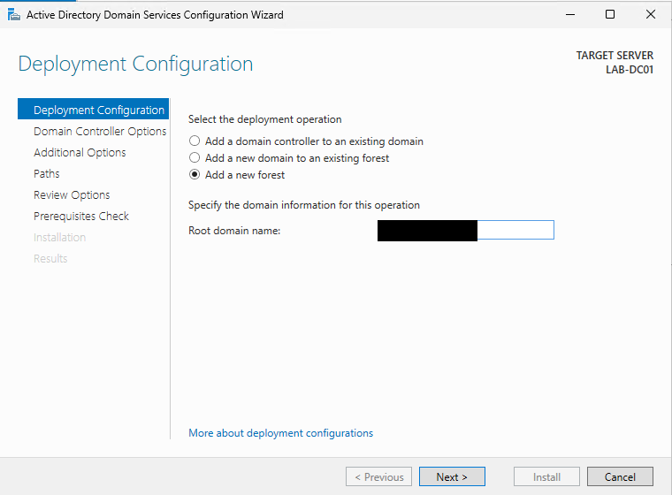

**07b — AD DS Configuration Wizard: domain controller configuration**

The review screen shows the selected functional levels, DNS and Global Catalog options, and the database, log and SYSVOL paths.

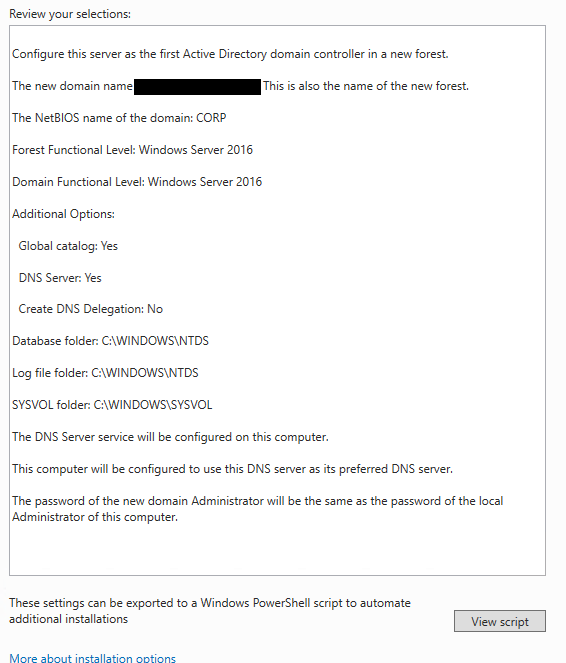

### Active Directory Verification

After promotion and the automatic restart, the domain administrator account was used to sign in. PowerShell was used to verify the domain, forest and domain controller:

```powershell
Get-ADDomain | Format-List DNSRoot, NetBIOSName, DomainMode

Get-ADForest | Format-List Name, ForestMode, Domains

Get-ADDomainController -Filter * |
    Format-Table HostName, IPv4Address, IsGlobalCatalog, IsReadOnly
```

The checks confirmed the following configuration:

| Item | Verified result |
|---|---|
| AD DS Domain | `corp.hybridlab.test` |
| NetBIOS Name | `CORP` |
| Forest | `corp.hybridlab.test` |
| Domain / Forest Functional Level | Windows Server 2016 |
| Domain Controller | `LAB-DC01.corp.hybridlab.test` |
| Domain Controller IPv4 | `192.168.50.10` |
| Global Catalog | Enabled |
| Read-Only Domain Controller | No |

**08 — PowerShell: domain, forest and domain controller verification**

The output confirms the domain and forest names, functional levels, domain controller address and Global Catalog status.

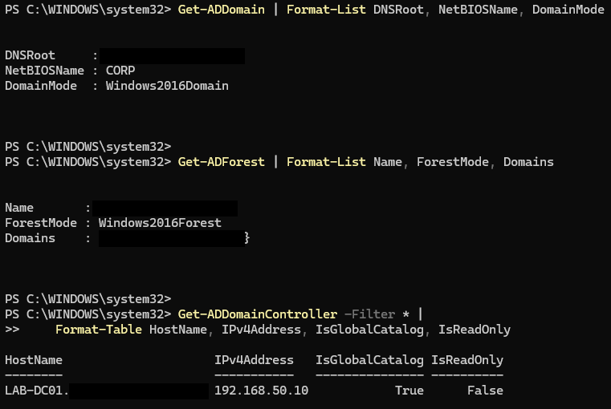

### DNS Configuration and Validation

The DNS role was installed on `LAB-DC01`, and the AD-integrated forward lookup zone for `corp.hybridlab.test` was created during domain controller promotion. The zone contained the expected AD-related subfolders and host records for `LAB-DC01` (`192.168.50.10`) and `LAB-WS01` (`192.168.50.20`).

**09 — DNS Manager: forward lookup zone**

The DNS console shows the `corp.hybridlab.test` zone and the host records for the lab servers.

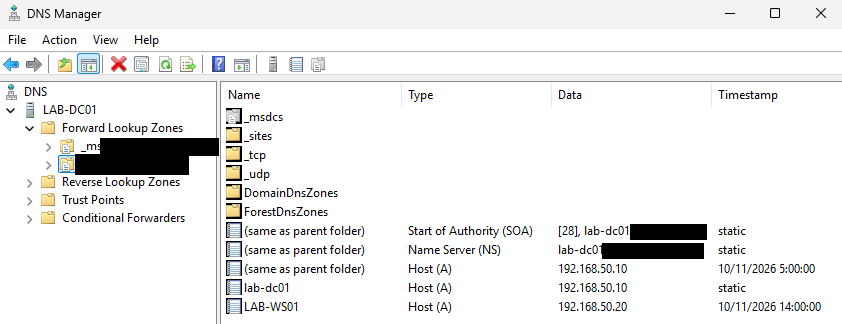

DNS forwarders were configured to allow the server to resolve external names that are not hosted in the lab's DNS zones:

- `1.1.1.1`
- `8.8.8.8`

The forwarders and the domain controller's LDAP service locator (SRV) record were checked with PowerShell:

```powershell
Get-DnsServerForwarder

Resolve-DnsName -Type SRV "_ldap._tcp.dc._msdcs.corp.hybridlab.test"
```

The SRV query returned `LAB-DC01.corp.hybridlab.test` as the target on TCP port `389`, with the corresponding address `192.168.50.10`.

**10 — PowerShell: DNS forwarders and LDAP SRV record**

The output verifies the configured forwarders and the LDAP domain controller locator record.

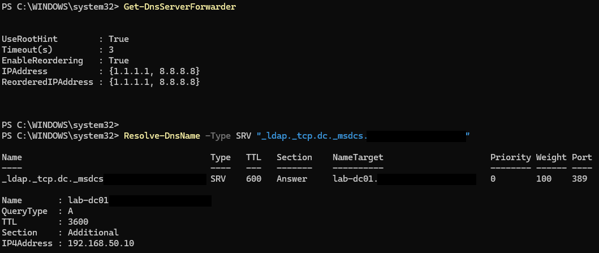

This phase validated forward and AD-related SRV lookups. Reverse lookup (PTR) resolution was not part of the DNS validation performed for this lab stage.

### Windows Time Service and PDC Emulator

`LAB-DC01` holds the PDC Emulator role for the forest-root domain. Its time source was configured to use `time.windows.com`. The initial synchronization issue, the Hyper-V integration setting and the commands used to correct it are documented in [Section 5.4](#54-domain-controller-time-synchronization).

**11 — PowerShell: NTP time synchronization**

The output confirms `time.windows.com,0x8` as the configured source and `Leap Indicator: 0 (no warning)` after synchronization.

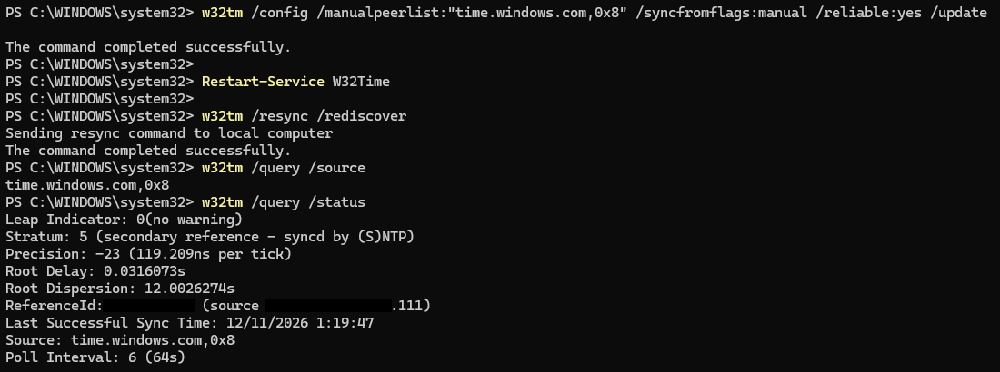

### Domain Controller Health Checks

After time synchronization was corrected, the following diagnostic tests were run:

```powershell
dcdiag /test:advertising
dcdiag /test:dns
```

Both tests passed.

**12 — PowerShell: DCDIAG Advertising test**

The final output shows that `LAB-DC01` passed the Advertising test.

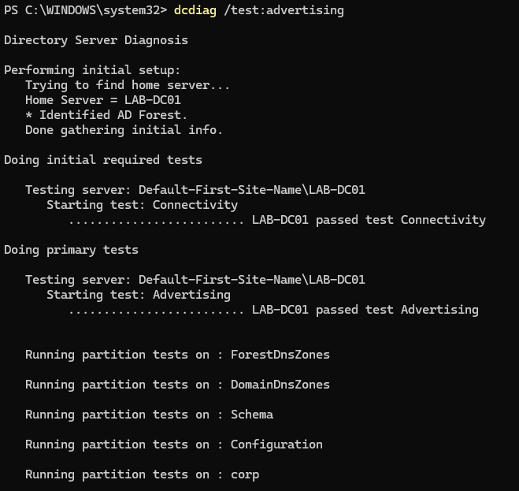

**13 — PowerShell: DCDIAG DNS test**

The final output shows that `LAB-DC01` and the domain passed the DNS test.

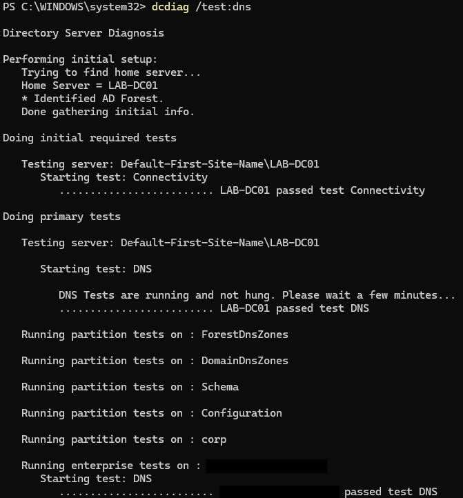

The core AD DS services and the `SYSVOL` and `NETLOGON` shares were also checked:

```powershell
Get-Service NTDS,DNS,Netlogon,DFSR |
    Format-Table Name,Status -AutoSize

Get-SmbShare -Name SYSVOL,NETLOGON
```

**14 — PowerShell: core services and SYSVOL / NETLOGON shares**

The output shows the NTDS, DNS, Netlogon and DFS Replication services running, and confirms that the `SYSVOL` and `NETLOGON` shares are present.

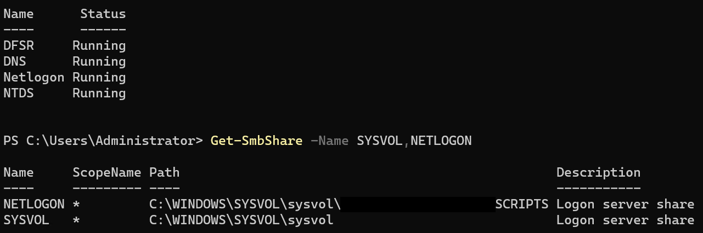

**Result:** `LAB-DC01` is operating as the first domain controller for `corp.hybridlab.test`. AD DS and DNS are installed, the domain and forest configuration has been verified, DNS locator records resolve to the domain controller, time synchronization is working, and the final DCDIAG Advertising and DNS tests passed.

---

## 3. Windows 11 Domain Join and Validation

### Objective

Configure the Windows 11 Enterprise Evaluation client (`LAB-WS01`) to use the lab network and DNS infrastructure, join the Active Directory domain `corp.hybridlab.test`, and verify domain membership, domain controller discovery and its secure channel with the domain controller.

The installed client is Windows 11 Enterprise Evaluation, version 26H2 (OS build `26300.9457`). Microsoft's [Windows 11 release information](https://learn.microsoft.com/en-us/windows/release-health/windows11-release-information) identifies build `26300.9457` as part of version 26H2.

### Client Network Configuration

The client was configured with a static IPv4 address so it could communicate with the domain controller on the isolated `LAB-AD` network.

| Setting | Value |
|---|---|
| Computer name | `LAB-WS01` |
| IPv4 address | `192.168.50.20` |
| Subnet mask | `255.255.255.0` (`/24`) |
| Default gateway | `192.168.50.1` |
| Preferred DNS server | `192.168.50.10` (`LAB-DC01`) |
| Active Directory domain | `corp.hybridlab.test` |

The domain controller is used as the client's DNS server because Active Directory domain discovery relies on DNS records, including the domain controller's SRV records. Before joining the domain, name resolution for `corp.hybridlab.test` was checked from the client.

**15 — LAB-WS01: network and DNS configuration**

The output shows the client's static IPv4 configuration, DNS server and successful resolution of the AD domain name.

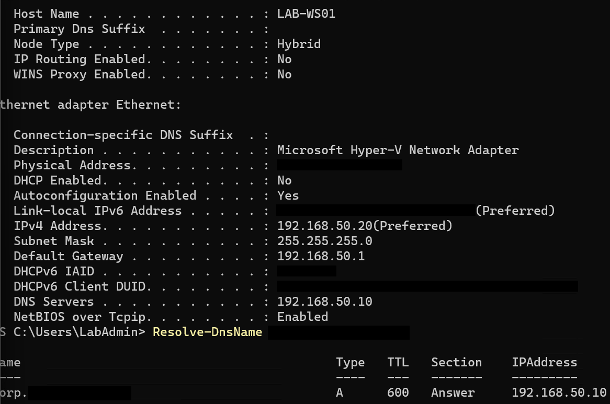

### Joining the Active Directory Domain

The client was joined to the domain using the PowerShell `Add-Computer` cmdlet. The command prompts for credentials with permission to join a computer to the domain:

```powershell
Add-Computer -DomainName "corp.hybridlab.test" -Credential (Get-Credential)
```

The command indicated that the change would take effect after restarting `LAB-WS01`. The workstation was then restarted to complete the domain join.

**16 — LAB-WS01: domain join operation**

The screenshot shows the `Add-Computer` command and the restart notice.

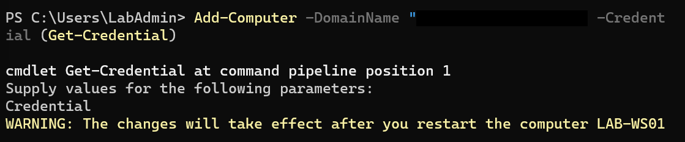

### Verifying Domain Membership

After the restart, domain membership was verified from the client with `Get-CimInstance`:

```powershell
Get-CimInstance Win32_ComputerSystem |
    Select-Object Name, Domain, PartOfDomain
```

The output identified the computer as `LAB-WS01`, returned `corp.hybridlab.test` as its domain, and showed `PartOfDomain` as `True`.

**17 — LAB-WS01: domain membership verification**

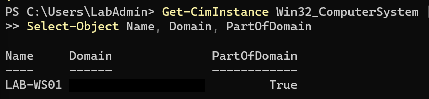

### Domain Controller Discovery and Secure Channel Validation

The final checks confirmed that the workstation was running in the domain context and could locate the domain controller. The secure channel test returned `True`.

```powershell
whoami
nltest /dsgetdc:corp.hybridlab.test
Test-ComputerSecureChannel -Verbose
```

The results showed the signed-in account as `corp\administrator`, located `LAB-DC01.corp.hybridlab.test` at `192.168.50.10`, and reported that the secure channel between `LAB-WS01` and `corp.hybridlab.test` was in good condition.

**18 — LAB-WS01: domain controller discovery and secure channel verification**

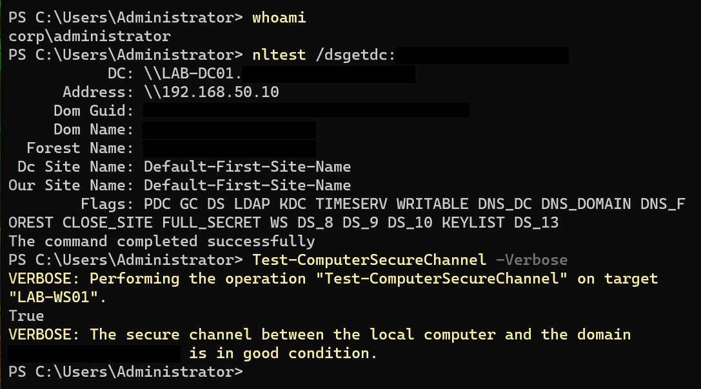

### Outcome and Key Takeaways

`LAB-WS01` successfully joined `corp.hybridlab.test`. The client resolved the domain through the lab DNS server, located `LAB-DC01`, and passed the secure channel check. These checks confirm domain membership, domain controller discovery and the workstation's machine secure channel.

- Domain-joined Windows clients should use the Active Directory DNS infrastructure for domain name and service discovery.
- The `Add-Computer` cmdlet can be used to join a Windows workstation to an Active Directory domain.
- `PartOfDomain`, `nltest /dsgetdc` and `Test-ComputerSecureChannel` provide complementary checks for domain membership, domain controller discovery and the workstation's secure channel.

**Technologies:** Windows 11 Enterprise Evaluation (version 26H2), Windows Server 2025 Standard Evaluation, AD DS, DNS, Hyper-V and PowerShell.

---

## 4. Microsoft Entra ID Integration and Hybrid Join

### Objective

Connect the on-premises Active Directory domain (`corp.hybridlab.test`) to the Microsoft Entra tenant (`hybridlab.onmicrosoft.com`) using **Microsoft Entra Cloud Sync**, synchronize a pilot user and security group, publish the Active Directory Service Connection Point (SCP) and Device Sync configuration, and complete **Microsoft Entra Hybrid Join** on `LAB-WS01`.

### Tenant Preparation and Alternative UPN Suffix

Two prerequisites were completed in AD DS before deploying Cloud Sync:

1. **Key Distribution Services (KDS) Root Key:** The Microsoft Entra Connect Provisioning Agent runs under a Group Managed Service Account (gMSA), which requires an active KDS Root Key in the forest.
2. **Alternative UPN Suffix:** Because `corp.hybridlab.test` is an internal testing domain, `hybridlab.onmicrosoft.com` was added in Active Directory Domains and Trusts so synchronized users authenticate with a verified cloud UPN.

| Parameter | Configuration |
|---|---|
| Microsoft Entra Tenant | `hybridlab.onmicrosoft.com` |
| Tenant ID | `<TENANT_ID>` |
| Alternative AD UPN Suffix | `hybridlab.onmicrosoft.com` |
| KDS Root Key | Created and verified on `LAB-DC01` |

**19 — PowerShell: KDS Root Key verification**

Output confirming an active KDS Root Key in AD DS to allow gMSA creation during agent installation.

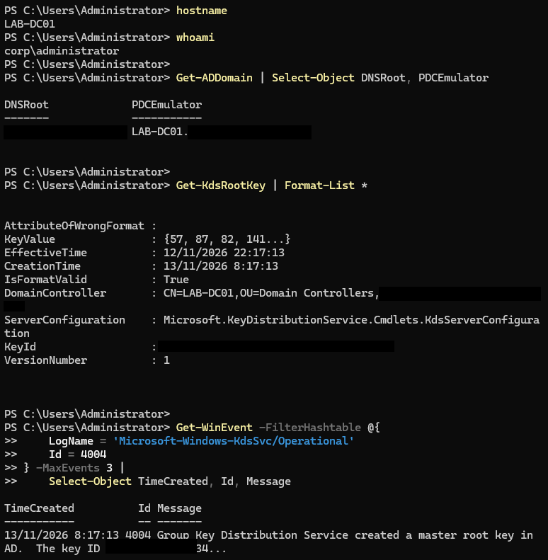

**20 — Microsoft Entra ID: tenant primary domain**

The Entra admin center confirming `hybridlab.onmicrosoft.com` as the primary verified domain.

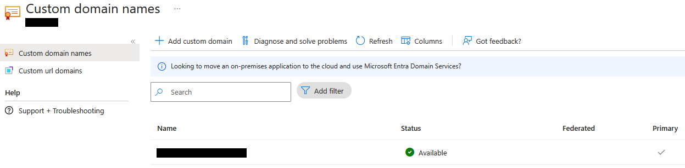

**21 — Active Directory Domains and Trusts: alternative UPN suffix**

`hybridlab.onmicrosoft.com` registered as an alternative UPN suffix in the forest properties.

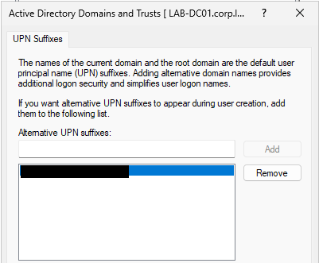

### Pilot Organizational Unit and Identity Objects

To keep the synchronization scope controlled, a dedicated pilot Organizational Unit (`OU=EntraSync-Pilot,DC=corp,DC=hybridlab,DC=test`) was created with one test user and one security group.

| Object Type | Name / UPN | Distinguished Name |
|---|---|---|
| Organizational Unit | `EntraSync-Pilot` | `OU=EntraSync-Pilot,DC=corp,DC=hybridlab,DC=test` |
| Pilot User | `Sync Pilot User` (`sync.pilot@hybridlab.onmicrosoft.com`) | `CN=Sync Pilot User,OU=EntraSync-Pilot,DC=corp,DC=hybridlab,DC=test` |
| Pilot Security Group | `SG-EntraSync-Pilot` | `CN=SG-EntraSync-Pilot,OU=EntraSync-Pilot,DC=corp,DC=hybridlab,DC=test` |

**22 — AD DS: EntraSync-Pilot Organizational Unit**

The dedicated `EntraSync-Pilot` OU created under `corp.hybridlab.test`.

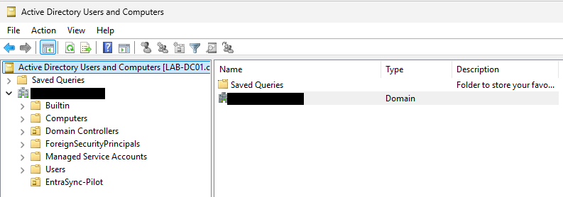

**23 — AD DS: pilot user creation**

`Sync Pilot User` created inside `OU=EntraSync-Pilot`.

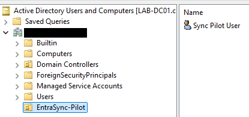

**24 — AD DS: pilot user UPN verification**

Account properties confirming the `@hybridlab.onmicrosoft.com` UPN suffix on `Sync Pilot User`.

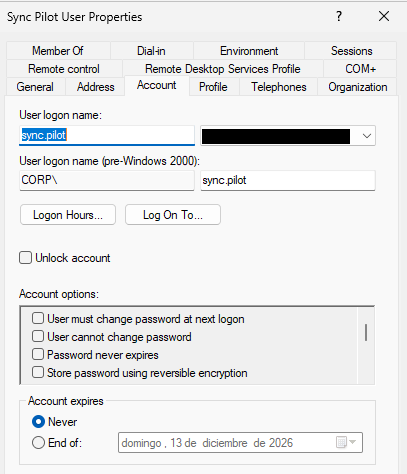

**25 — AD DS: pilot security group membership**

`SG-EntraSync-Pilot` created as a Global Security Group with `Sync Pilot User` as a member.

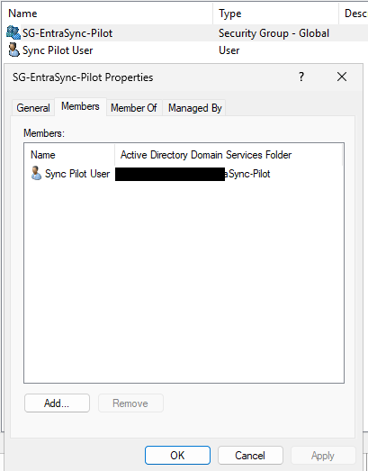

### Microsoft Entra Cloud Sync Agent Deployment

Before installing the provisioning agent on `LAB-DC01`, .NET prerequisites and outbound TLS 1.2 connectivity to Microsoft Entra endpoints were checked in PowerShell. The installation wizard configured the gMSA (`CORP\<GMSA_ACCOUNT>`) and registered the agent in Entra ID.

**26 — PowerShell: Cloud Sync agent prerequisites**

Verification of host prerequisites on `LAB-DC01`.

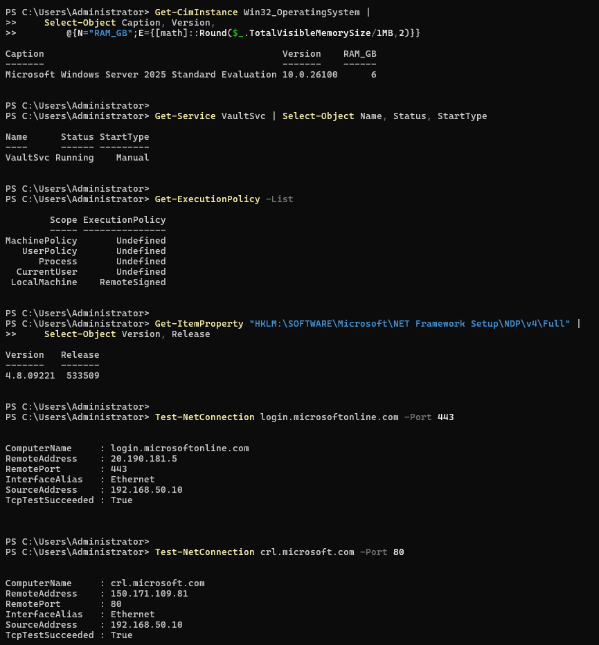

**27 — PowerShell: TLS 1.2 and endpoint connectivity verification**

Confirmation that TLS 1.2 is active and outbound HTTPS checks succeed.

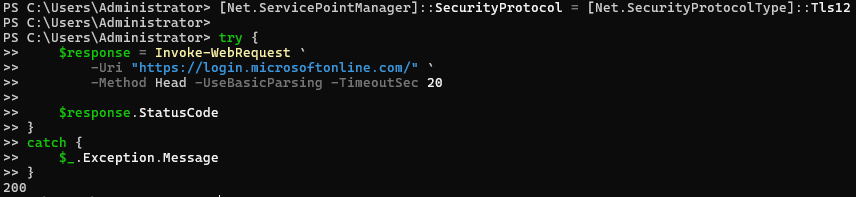

**28 — Cloud Sync Agent Wizard: configuration review**

Summary of the domain, gMSA and tenant registration settings prior to installation.

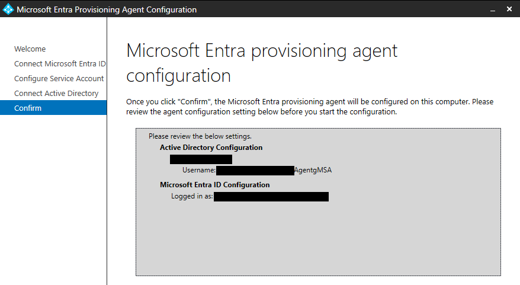

**29 — Cloud Sync Agent Wizard: installation complete**

Confirmation that the agent service installation succeeded on `LAB-DC01`.

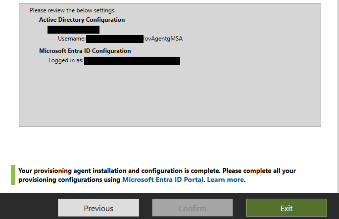

**30 — Microsoft Entra ID: registered provisioning agent**

The Entra admin center showing `LAB-DC01.corp.hybridlab.test` registered with `Active` status.

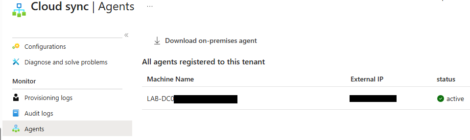

### User and Group Provisioning Configuration

The Cloud Sync configuration for `corp.hybridlab.test` was initially scoped to `OU=EntraSync-Pilot,DC=corp,DC=hybridlab,DC=test`. Provisioning was validated first via **Provision on demand** before enabling scheduled synchronization, confirming that both `Sync Pilot User` and `SG-EntraSync-Pilot` (with its group membership) appeared in Entra ID.

**31 — Cloud Sync: initial OU scoping configuration**

Scoping filter set to *Sync selected organizational units* (`OU=EntraSync-Pilot`).

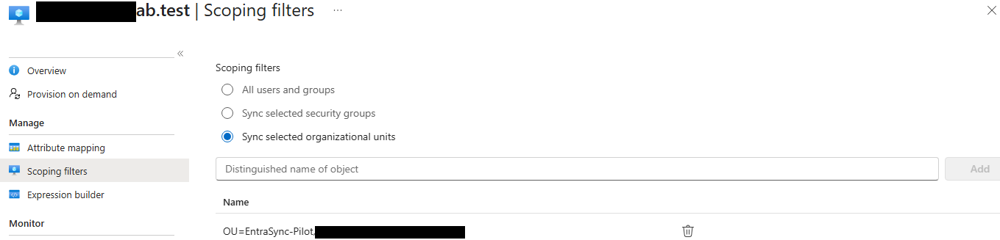

**32 — PowerShell: pilot identity verification in AD DS**

Verification of the pilot user and group objects in Active Directory before running provisioning.

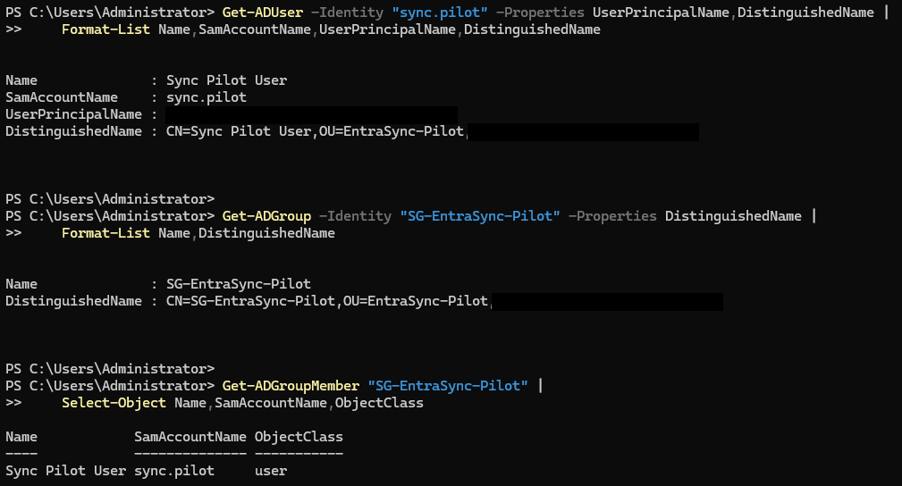

**33 — Cloud Sync: on-demand user provisioning**

On-demand provisioning output confirming import, scope evaluation and export for `Sync Pilot User`.

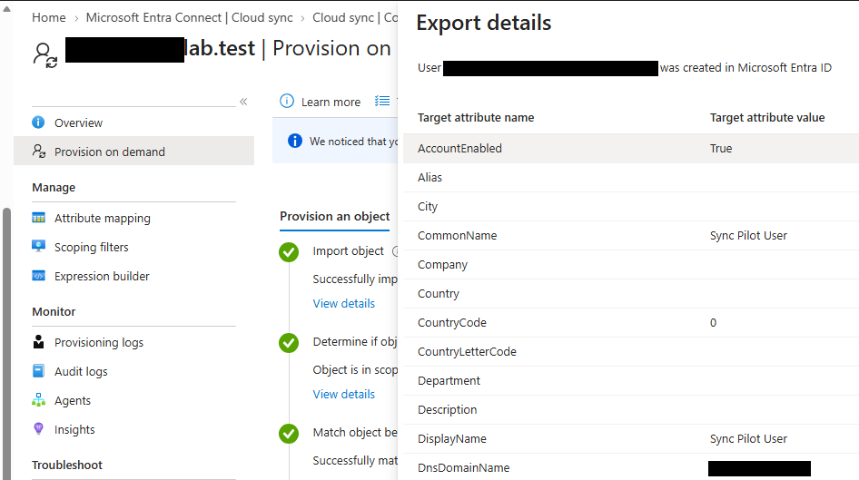

**34 — Cloud Sync: configuration review**

Review of the synchronization settings prior to enabling the job.

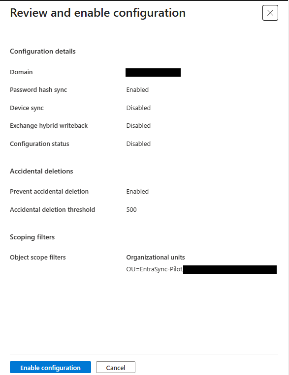

**35 — Cloud Sync: configuration enabled**

Activation of the synchronization configuration for `corp.hybridlab.test`.

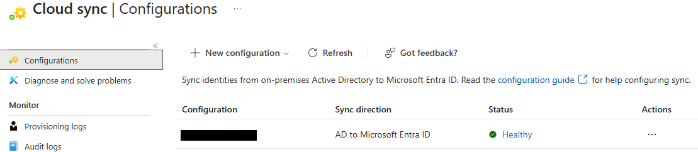

**36 — Cloud Sync: configuration overview**

Overview blade showing the active Cloud Sync configuration.

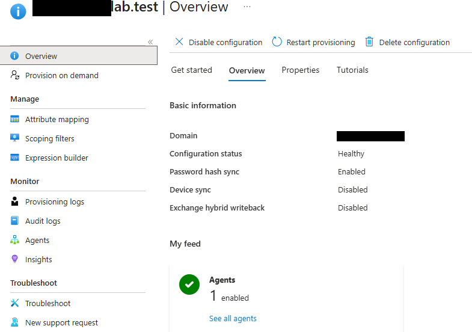

**37 — Provisioning logs: user provisioning success**

Provisioning log entry confirming `Sync Pilot User` created in Microsoft Entra ID.

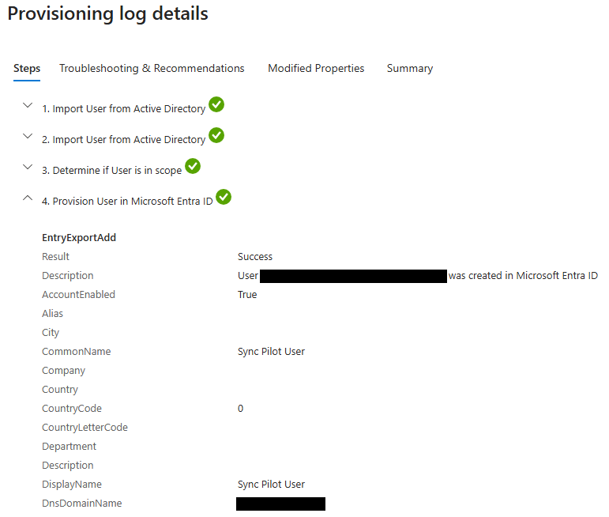

**38 — Provisioning logs: group provisioning success**

Provisioning log entry confirming `SG-EntraSync-Pilot` created in Microsoft Entra ID.

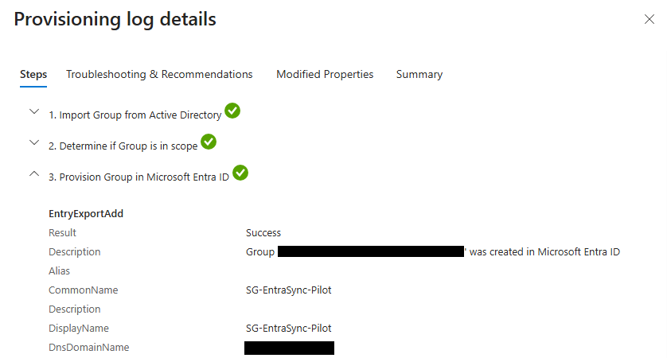

**39 — Microsoft Entra ID: synced security group overview**

`SG-EntraSync-Pilot` visible in Entra ID with on-premises directory sync enabled.

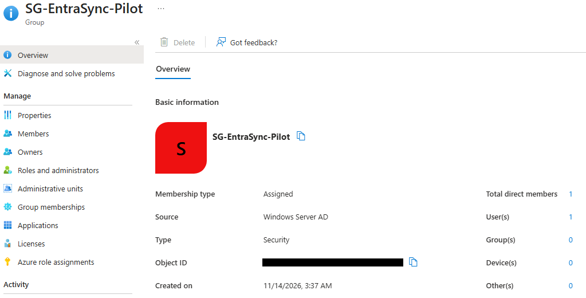

**40 — Microsoft Entra ID: synced group membership verification**

Confirmation that `Sync Pilot User` is listed as a member of `SG-EntraSync-Pilot` in Entra ID.

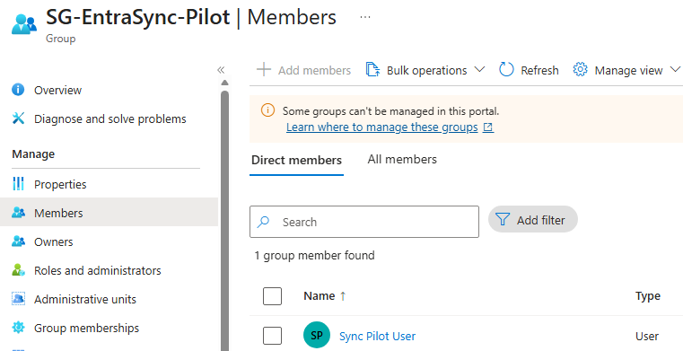

### Service Connection Point (SCP) and Device Sync Configuration

For domain-joined Windows devices to discover which Entra tenant to register with during Hybrid Join, a Service Connection Point (SCP) was created in the AD DS Configuration partition using Microsoft's `ConfigureSCP.ps1` script, and Device Sync (`AD2AADDeviceSync`) was enabled in Cloud Sync.

| SCP Attribute | Configured Value |
|---|---|
| Object Path | `CN=<SCP_OBJECT_GUID>,CN=Device Registration Configuration,CN=Services,CN=Configuration,DC=corp,DC=hybridlab,DC=test` |
| `keywords` | `azureADName:hybridlab.onmicrosoft.com`, `azureADId:<TENANT_ID>` |

**41 — PowerShell: SCP configuration execution**

Running `ConfigureSCP.ps1` on `LAB-DC01` to register the tenant name and ID in AD DS.

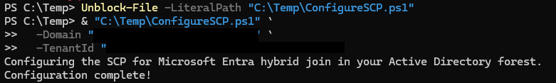

**43 — PowerShell: SCP verification in AD DS**

`Get-ADObject` confirming the SCP keywords (`azureADName` and `azureADId`) in the Configuration partition.

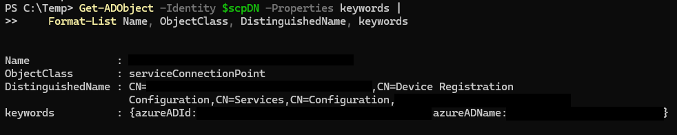

**44 — Cloud Sync: Device Sync enabled**

Enabling the `AD2AADDeviceSync` job in the Cloud Sync portal.

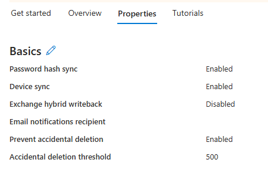

### Workstation OU Scoping, Device Provisioning and Hybrid Join Validation

As detailed in [Sections 5.7–5.9](#57-device-sync-joinnotfound-and-missing-usercertificate-attribute), a dedicated Organizational Unit (`OU=Workstations-Pilot,DC=corp,DC=hybridlab,DC=test`) was created for pilot workstations, `LAB-WS01` was moved out of the default `CN=Computers` container into that OU, and `OU=Workstations-Pilot` was added to Cloud Sync's scoping filters.

```powershell
New-ADOrganizationalUnit -Name "Workstations-Pilot" -Path "DC=corp,DC=hybridlab,DC=test"
Get-ADComputer "LAB-WS01" | Move-ADObject -TargetPath "OU=Workstations-Pilot,DC=corp,DC=hybridlab,DC=test"
```

**56 — PowerShell: Workstations-Pilot OU creation and computer move**

`LAB-WS01` moved to `CN=LAB-WS01,OU=Workstations-Pilot,DC=corp,DC=hybridlab,DC=test` with its `userCertificate` intact (`CertCount: 1`).

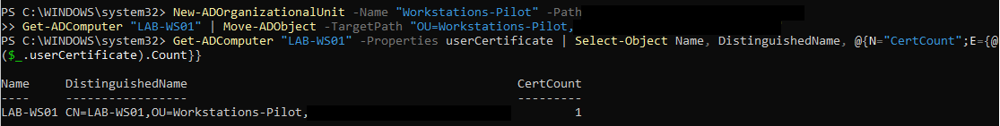

**57 — Cloud Sync: Workstations-Pilot added to scoping filters**

Both `OU=EntraSync-Pilot` and `OU=Workstations-Pilot` configured under *Sync selected organizational units*.

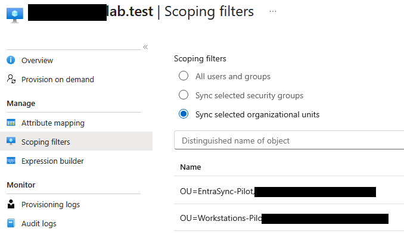

On the following synchronization cycle, Microsoft Graph confirmed that `LAB-WS01` (`deviceId: <DEVICE_GUID>`) was created in Microsoft Entra ID with `trustType: ServerAd`. The `Automatic-Device-Join` scheduled task was then run on `LAB-WS01` to complete the registration:

```powershell
Start-ScheduledTask -TaskPath "\Microsoft\Windows\Workplace Join\" -TaskName "Automatic-Device-Join"
dsregcmd /status
```

**58 — PowerShell (Microsoft Graph): Entra device object provisioned**

Query against `/v1.0/devices` confirming `LAB-WS01` provisioned in Entra ID (`trustType: ServerAd`).

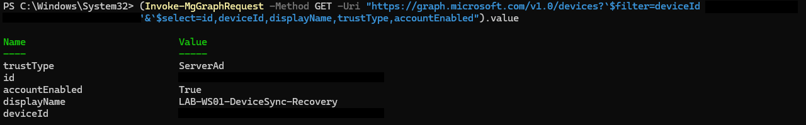

**59 — PowerShell (LAB-WS01): Hybrid Join verification**

`dsregcmd /status` on `LAB-WS01` reporting `AzureAdJoined : YES` and `DomainJoined : YES`.

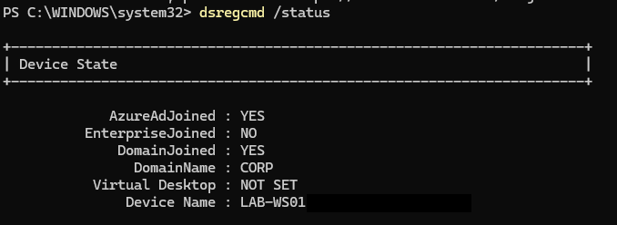

**60 — Microsoft Entra ID: LAB-WS01 listed as Hybrid Joined**

The *Devices → All devices* blade showing `LAB-WS01` enabled with join type **Microsoft Entra hybrid joined**.

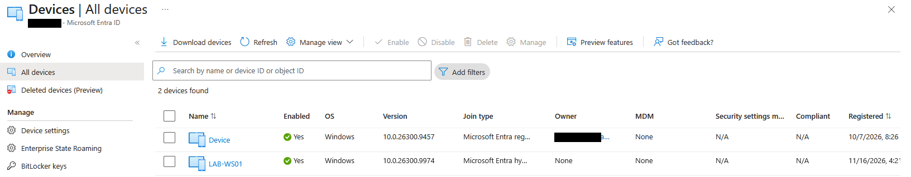

Finally, the temporary `displayName` value (`LAB-WS01-DeviceSync-Recovery`) set during troubleshooting was cleared in AD DS so the computer object keeps its clean default naming convention:

```powershell
Set-ADComputer -Identity "LAB-WS01" -Clear displayName
Get-ADComputer "LAB-WS01" -Properties displayName | Select-Object Name, displayName, DistinguishedName
```

**61 — PowerShell: AD DS displayName attribute cleanup**

Verification that `displayName` was cleared on `LAB-WS01` in `OU=Workstations-Pilot`.

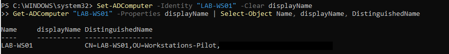

### Outcome and Key Takeaways

`LAB-WS01` achieved **Microsoft Entra Hybrid Join** (`AzureAdJoined : YES` and `DomainJoined : YES`) alongside synchronized user and group identities in `hybridlab.onmicrosoft.com`.

- Non-routable AD domains require a verified alternative UPN suffix (`hybridlab.onmicrosoft.com`) so synchronized users can authenticate against Entra ID.
- Microsoft Entra Hybrid Join with Cloud Sync requires three pieces working together: an SCP in AD DS pointing to the tenant, a client-generated `userCertificate` attribute on the AD computer object, and the computer's Organizational Unit included in Cloud Sync's scoping filters.
- Keeping user/group pilot OUs (`OU=EntraSync-Pilot`) separate from workstation OUs (`OU=Workstations-Pilot`) mirrors standard AD organization and Group Policy delegation practices.

**Technologies:** Microsoft Entra ID, Microsoft Entra Cloud Sync, Microsoft Graph REST API / PowerShell SDK, AD DS (SCP, gMSA, KDS), Windows Server 2025 and Windows 11 Enterprise (26H2).

---

## 5. Troubleshooting and Validation Results

This section records the issues encountered while building the lab, the actions taken to resolve them, and the checks used to confirm the final configuration. It focuses on observed behaviour in this environment rather than generic troubleshooting scenarios.

### 5.1. Windows Server installation boot

**Observed issue:** On the first attempt, the virtual machine did not boot from the mounted Windows Server ISO. The DVD boot attempt failed and the VM proceeded to network/PXE boot, where no boot device was available.

**Resolution:** The VM was restarted and a key was pressed when the installer displayed the prompt to boot from the DVD. Windows Server Setup then started successfully.

### 5.2. Windows 11 OOBE on the isolated lab network

**Observed issue:** During Windows 11 first-run setup (OOBE), the workstation had no Internet connection. The `LAB-AD` internal network did not provide DHCP, so the VM could not obtain an address automatically.

**Resolution:** The offline setup path was selected with `OOBE\BYPASSNRO`, allowing OOBE to continue with a local account. After setup, a static network configuration was applied to `LAB-WS01`:

| Setting | Value |
|---|---|
| IPv4 address | `192.168.50.20/24` |
| Default gateway | `192.168.50.1` |
| Preferred DNS server | `192.168.50.10` |

Connectivity and name resolution were then verified before joining the domain. See [15 — Network and DNS Configuration](../Screenshots/Def/03-Windows-11-Domain-Join/15-LAB-WS01-Network-DNS-Configuration.png).

### 5.3. DNS delegation warning during forest creation

**Observed issue:** The AD DS Configuration Wizard displayed a warning that a DNS delegation could not be created because the authoritative parent zone could not be found.

**Resolution:** This was expected for this isolated lab namespace. The new forest root domain, `corp.hybridlab.test`, did not have an existing parent DNS zone in which to create a delegation. The **Create DNS delegation** option was therefore left unchecked. The DNS role and AD-integrated forward lookup zone were configured on `LAB-DC01`.

### 5.4. Domain Controller time synchronization

**Observed issue:** The initial `dcdiag` run passed the DNS test but failed the Advertising test, reporting that `LAB-DC01` was not advertising as a time server. The Windows Time status showed `Leap Indicator: 3` (not synchronized), with the Hyper-V time integration provider as its source.

**Resolution:** Hyper-V time synchronization was disabled for the domain controller VM through **Hyper-V Settings → Integration Services → Time synchronization**. The PDC Emulator was then configured to use the external NTP peer `time.windows.com`:

```powershell
w32tm /config /manualpeerlist:"time.windows.com,0x8" /syncfromflags:manual /reliable:yes /update
Restart-Service W32Time
w32tm /resync /rediscover
```

**Verification:** `w32tm /query /source` reported `time.windows.com,0x8`, and `w32tm /query /status` reported `Leap Indicator: 0` (no warning). The subsequent `dcdiag /test:advertising` passed. See [11 — NTP Time Synchronization](../Screenshots/Def/02-ADDS/11-PowerShell-NTP-Time-Synchronization.png) and [12 — DCDIAG Advertising Test](../Screenshots/Def/02-ADDS/12-PowerShell-DCDIAG-Advertising.png).

### 5.5. Evaluation editions and activation

Both guest operating systems were installed from Evaluation media: Windows Server 2025 Standard Evaluation and Windows 11 Enterprise Evaluation (version 26H2). Evaluation editions are intended for trial and learning use and are not permanent production licences.

During Windows 11 setup, the client initially displayed an evaluation activation notification. After network connectivity was configured, activation completed successfully with `slmgr`; `slmgr /xpr` reported an evaluation expiration date of **8 February 2027** at the time of testing. This confirms activation for the evaluation period; it does not convert the installation into a perpetual licence. No product keys or activation identifiers are included in this repository.

### 5.6. PowerShell execution policy block running `ConfigureSCP.ps1`

**Observed issue:** Running `ConfigureSCP.ps1` on `LAB-DC01` to register the Hybrid Join Service Connection Point was blocked by PowerShell's default script execution policy.

**42 — PowerShell: ConfigureSCP.ps1 execution policy block**

PowerShell blocking the configuration script before adjusting the process execution policy.


**Resolution:** A temporary, process-scoped bypass (`Set-ExecutionPolicy -Scope Process -ExecutionPolicy Bypass`) was applied for that single administrative PowerShell window so the script could run without changing system-wide security defaults. Verification of the SCP object is shown in [43 — SCP Verification](../Screenshots/Def/04-Entra-Hybrid-Identity/43-PowerShell-Entra-Hybrid-Join-SCP-Verification.png).

### 5.7. Device Sync `JoinNotFound` and missing `userCertificate` attribute

**Observed issue:** After enabling Device Sync (`AD2AADDeviceSync`), provisioning checks for `LAB-WS01` (`objectGUID: <DEVICE_GUID>`) were skipped with `SkipReason: JoinNotFound`, and `dsregcmd /status` on `LAB-WS01` showed `AzureAdJoined : NO` with error `0x801c03f3` (`error_missing_device`).

**Diagnosis:** Querying `LAB-WS01` in AD DS showed `userCertificateCount = 0`. Because `LAB-WS01` had been powered off after the SCP was created, Windows had not yet run its `Automatic-Device-Join` scheduled task to generate a device certificate and write it to the `userCertificate` attribute in AD. Cloud Sync's device scoping filter requires `userCertificate` to be present before synchronizing a Windows computer object.

**45 — Cloud Sync: initial Device Sync `JoinNotFound`**

Provisioning details showing `LAB-WS01` skipped with `SkipReason: JoinNotFound`.


**46 — PowerShell: `LAB-WS01` `userCertificate` baseline (`0`)**

Baseline check on `LAB-DC01` confirming no certificate existed on the computer object while `LAB-WS01` was powered off.


**47 — PowerShell: `LAB-WS01` `userCertificate` generated (`1`)**

After powering on `LAB-WS01` and signing in, the workstation generated and published its certificate (`UserCertificateCount : 1`) to AD DS.


**48 — Cloud Sync: `JoinNotFound` persisting after certificate generation**

Even after `userCertificate` was populated, provisioning still skipped `LAB-WS01` with `JoinNotFound`, pointing to two additional issues resolved in Sections 5.8 and 5.9.


### 5.8. Cloud Sync quarantine (`HybridIdentityServiceNoActiveAgents`) due to missing `Endpoints` folder

**Observed issue:** Both User/Group Sync and Device Sync went into quarantine with `HybridIdentityServiceNoActiveAgents`, even though the `AADConnectProvisioningAgent` service was running on `LAB-DC01` and appeared `Active` in the Entra portal.

**Diagnosis:** Inspecting the agent logs under `C:\ProgramData\Microsoft\Azure AD Connect Provisioning Agent` revealed a `System.UnauthorizedAccessException` when the gMSA (`CORP\<GMSA_ACCOUNT>`) tried to access `C:\ProgramData\Microsoft\Azure AD Connect Provisioning Agent\Endpoints`, which did not exist on disk.

**Resolution:** The missing `Endpoints` folder was created from an elevated PowerShell session on `LAB-DC01` (inheriting permissions for the gMSA) and the agent service was restarted:

```powershell
$base = "C:\ProgramData\Microsoft\Azure AD Connect Provisioning Agent"
$endpoints = Join-Path $base "Endpoints"
New-Item -Path $endpoints -ItemType Directory
Restart-Service AADConnectProvisioningAgent
```

After restarting, the agent generated `Endpoints\endpoints.txt`, reconnected to Entra ID, and returned Cloud Sync to `Healthy`.

**50 — Cloud Sync: quarantine state (`HybridIdentityServiceNoActiveAgents`)**

Provisioning configuration showing quarantine prior to creating the `Endpoints` directory.


**53 — Cloud Sync: configuration restored to `Healthy`**

Status after creating the `Endpoints` folder and restarting `AADConnectProvisioningAgent`.


**54 — Cloud Sync: Device Sync incremental cycle completed**

`AD2AADDeviceSync` completing its incremental cycle at 100% after agent recovery.


### 5.9. `EntryImportDelete` / `JoinNotFound` loop caused by `CN=Computers` being outside OU scope

**Observed issue:** Even after resolving the agent quarantine (`49`, `53`, `54`), `AD2AADDeviceSync` continued skipping `LAB-WS01` with an `EntryImportDelete` → `EntryImport` → `JoinNotFound` sequence (`51`, `52`). Querying Microsoft Graph (`/v1.0/devices` and `/beta/directory/deletedItems/microsoft.graph.device`) confirmed that no active or soft-deleted device object existed in Entra ID for `<DEVICE_GUID>`.

**49 — Cloud Sync: Device Sync quarantine state**

Job status showing `AD2AADDeviceSync` quarantined with `HybridIdentityServiceNoActiveAgents` prior to fixing the `Endpoints` directory.


**51 — Provisioning logs: `EntryImportDelete` and `JoinNotFound` steps**

Step-by-step evaluation showing `EntryImportDelete` followed by `EntrySynchronizationSkip` (`JoinNotFound`).


**52 — Provisioning logs: summary showing `Action: delete` and empty `Target ID`**

Summary blade confirming no target device had been created in Entra ID.


**Diagnosis:** Triggering a full watermark reset (`resetScope = "Full"`) on `AD2AADDeviceSync` through the Microsoft Graph REST API completed with `state: Succeeded` but returned **`countImported: 0`**. This confirmed that the connector was not reading `LAB-WS01` during regular sync cycles because the computer object was still located in the default **`CN=Computers`** container, while Cloud Sync's scoping filter only monitored **`OU=EntraSync-Pilot`**. (Because *Provision on demand* evaluates attribute filters directly on a manually entered DN, it showed the device as in scope even though `CN=Computers` was excluded from scheduled sync.)

**55 — PowerShell (Microsoft Graph): full reset of `AD2AADDeviceSync` returning `countImported: 0`**

Graph REST API `restart` (`resetScope = "Full"`) and `lastExecution` status confirming zero objects were imported while `LAB-WS01` remained in `CN=Computers`.


**Resolution:** Created `OU=Workstations-Pilot,DC=corp,DC=hybridlab,DC=test`, moved `LAB-WS01` into it (`56`), and added `OU=Workstations-Pilot` to Cloud Sync's scoping filters (`57`). On the next cycle, Cloud Sync provisioned `LAB-WS01` to Entra ID (`58`), allowing `Automatic-Device-Join` on `LAB-WS01` to complete Hybrid Join (`59`, `60`).

### 5.10. Final validation results

The following checks were completed after configuration and troubleshooting:

| Area | Verification | Result |
|---|---|---|
| AD DS and DNS roles | `Get-WindowsFeature AD-Domain-Services, DNS` | Both roles reported as `Installed` |
| Domain and forest | `Get-ADDomain`, `Get-ADForest` | `corp.hybridlab.test`; NetBIOS name `CORP`; Windows Server 2016 domain and forest functional levels |
| Domain Controller discovery | `Get-ADDomainController` and `nltest /dsgetdc:corp.hybridlab.test` | `LAB-DC01.corp.hybridlab.test` discovered at `192.168.50.10` |
| DNS service records | `Resolve-DnsName -Type SRV "_ldap._tcp.dc._msdcs.corp.hybridlab.test"` | LDAP SRV record resolved to `LAB-DC01.corp.hybridlab.test` on port `389` |
| DNS diagnostics | `dcdiag /test:dns` | Passed |
| DC advertising | `dcdiag /test:advertising` | Passed after time synchronization was corrected |
| Time synchronization | `w32tm /query /status` | Synchronized with `time.windows.com`; `Leap Indicator: 0` |
| DC services and shares | `Get-Service NTDS,DNS,Netlogon,DFSR`; `Get-SmbShare -Name SYSVOL,NETLOGON` | `NTDS`, `DNS`, `Netlogon` and `DFSR` were running; `SYSVOL` and `NETLOGON` shares were present |
| Workstation domain membership | `Get-CimInstance Win32_ComputerSystem` | `LAB-WS01` reported `PartOfDomain = True` |
| Workstation secure channel | `Test-ComputerSecureChannel -Verbose` | Returned `True` |
| Alternative UPN suffix & KDS | AD Domains and Trusts / `Get-KdsRootKey` | `hybridlab.onmicrosoft.com` configured; KDS Root Key active |
| Cloud Sync Agent & health | Entra admin center / `AADConnectProvisioningAgent` | Agent `Active` on `LAB-DC01`; configuration `Healthy` after `Endpoints` folder fix |
| Pilot user and group sync | Entra admin center / Provisioning logs | `Sync Pilot User` and `SG-EntraSync-Pilot` provisioned with membership intact |
| Hybrid Join SCP & Device Sync | `Get-ADObject` / Microsoft Graph `/v1.0/devices` | SCP verified; `LAB-WS01` (`<DEVICE_GUID>`) provisioned with `trustType = ServerAd` |
| Workstation Hybrid Join | `dsregcmd /status` & Entra *All devices* | `AzureAdJoined = YES`, `DomainJoined = YES`, `DeviceAuthStatus = SUCCESS` |

### 5.11. Lab limitations and production considerations

This is a **single-host learning lab**, not a production-ready AD DS or hybrid identity design. The environment has one writable domain controller (`LAB-DC01`) and one Microsoft Entra Connect Provisioning Agent installed directly on that domain controller. In production, Microsoft recommends deploying at least two virtualized domain controllers across separate virtualization hosts and installing multiple Cloud Sync provisioning agents on dedicated member servers (rather than domain controllers) for high availability ([Microsoft Learn: Virtualizing domain controllers with Hyper-V](https://learn.microsoft.com/en-us/windows-server/identity/ad-ds/get-started/virtual-dc/virtualized-domain-controllers-hyper-v); [Microsoft Learn: Prerequisites for Microsoft Entra Cloud Sync](https://learn.microsoft.com/en-us/entra/identity/hybrid/cloud-sync/how-to-prerequisites)).

Storage was simplified for this learning environment: each VM uses one dynamically expanding 80 GB VHDX, and the domain controller's AD DS database, log files and SYSVOL are located on the system volume (`C:`). Microsoft recommends placing the AD DS database, logs and SYSVOL on a separate virtual SCSI disk from the operating system, and recommends fixed-size VHDs or pass-through storage for performance and write durability ([Microsoft Learn: Virtualizing domain controllers with Hyper-V](https://learn.microsoft.com/en-us/windows-server/identity/ad-ds/get-started/virtual-dc/virtualized-domain-controllers-hyper-v)).

No validated AD-aware system-state backup and recovery procedure has been implemented in this phase. Hyper-V checkpoints or VM snapshots are not a substitute for a supported domain controller backup; Microsoft advises against taking or using snapshots of virtualized domain controllers. Microsoft recommends a guest-level system-state backup using a compatible backup application, such as Windows Server Backup ([Microsoft Learn: Virtualizing domain controllers with Hyper-V](https://learn.microsoft.com/en-us/windows-server/identity/ad-ds/get-started/virtual-dc/virtualized-domain-controllers-hyper-v)).

Finally, `dsregcmd /status` was captured while signed in as the local domain administrator (`CORP\Administrator`), which does not have a synchronized Entra identity and therefore reports `AzureAdPrt : NO`. Signing into `LAB-WS01` with a synchronized user account (`sync.pilot@hybridlab.onmicrosoft.com`) issues a Primary Refresh Token (`AzureAdPrt : YES`) for Single Sign-On to Microsoft Entra resources.

### Overall Result

The hybrid identity lab is operational: `LAB-DC01` provides AD DS and DNS for `corp.hybridlab.test`, Microsoft Entra Cloud Sync synchronizes scoped users, groups and workstations to `hybridlab.onmicrosoft.com`, and `LAB-WS01` is both domain-joined and Microsoft Entra hybrid-joined (`AzureAdJoined : YES`, `DomainJoined : YES`).

---

## References

- [IANA — .test top-level domain](https://www.iana.org/domains/root/db/test)
- [Microsoft Learn — Active Directory Domain Services functional levels](https://learn.microsoft.com/en-us/windows-server/identity/ad-ds/active-directory-functional-levels)
- [Microsoft Learn — Virtualizing domain controllers with Hyper-V](https://learn.microsoft.com/en-us/windows-server/identity/ad-ds/get-started/virtual-dc/virtualized-domain-controllers-hyper-v)
- [Microsoft Learn — Windows Time Service](https://learn.microsoft.com/en-us/windows-server/networking/windows-time-service/windows-time-service)
- [Microsoft Learn — Windows Time Service tools and settings](https://learn.microsoft.com/en-us/windows-server/networking/windows-time-service/Windows-Time-Service-Tools-and-Settings)
- [Microsoft Learn — Windows 11 release information](https://learn.microsoft.com/en-us/windows/release-health/windows11-release-information)
- [Microsoft Learn — Prerequisites for Microsoft Entra Cloud Sync](https://learn.microsoft.com/en-us/entra/identity/hybrid/cloud-sync/how-to-prerequisites)
- [Microsoft Learn — Configure Microsoft Entra hybrid join](https://learn.microsoft.com/en-us/entra/identity/devices/how-to-hybrid-join)