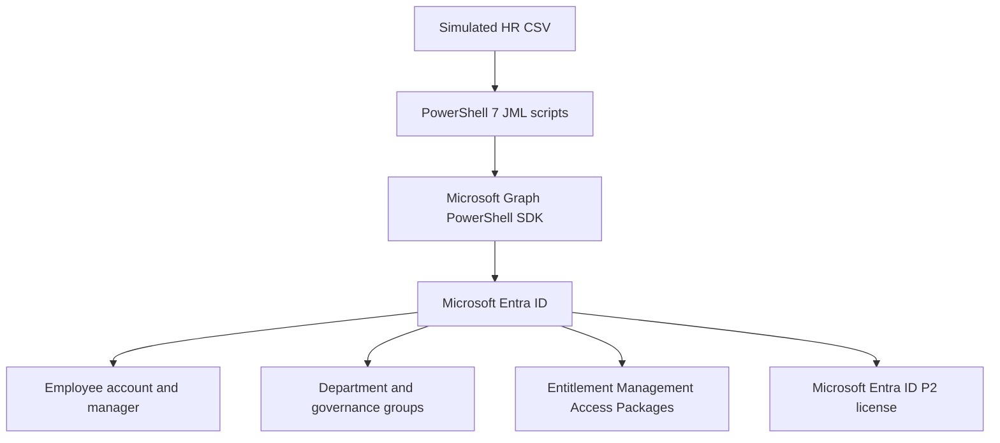
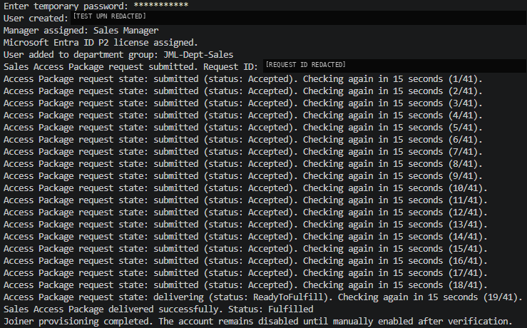
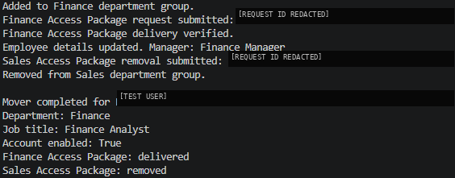
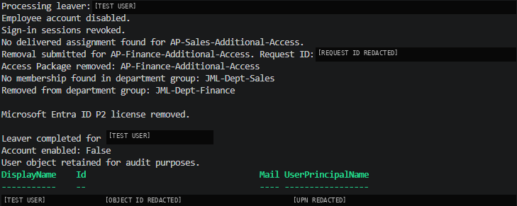

# PowerShell + Microsoft Graph: JML User Lifecycle Automation

> **Joiner, Mover and Leaver automation with Microsoft Entra ID**
>
> This is an IAM lab demonstrating how a simulated HR CSV input can drive common identity lifecycle operations using PowerShell and Microsoft Graph.

## Overview

This lab automates three identity lifecycle scenarios in Microsoft Entra ID:

- **Joiner:** create a new employee account, assign its manager, Microsoft Entra ID P2 license, department group and Sales Access Package.
- **Mover:** transfer an employee from Sales to Finance, update their department, job title and manager, grant Finance access, then remove the previous Sales access.
- **Leaver:** disable the account, revoke sign-in sessions, remove the lab-managed Access Package assignments and department-group memberships, remove the P2 license and retain the user object for audit purposes.

The HR source is a **simulated CSV export**. This lab does not implement a live HR integration or SCIM provisioning.

## Objectives

- Practise common Joiner–Mover–Leaver (JML) operations with Microsoft Entra ID.
- Use PowerShell and Microsoft Graph PowerShell SDK for repeatable identity administration.
- Combine department-based group access with additional access governed by Entitlement Management.
- Handle asynchronous Access Package assignment requests and transient directory-propagation delays.
- Verify outcomes instead of treating a submitted request as a completed operation.

## Architecture



## Repository structure

```text
PowerShell-MGraph-Lab02-JML-User-Lifecycle-Automation/
├── README.md
├── data/
│   └── hr-new-hire.example.csv
├── images/
│   ├── joiner-success.png
│   ├── mover-success.png
│   ├── leaver-success.png
│   └── joiner-entitlement-retry.png
└── scripts/
    ├── jml-joiner.ps1
    ├── jml-mover.ps1
    └── jml-leaver.ps1
```

The `images/` folder contains the redacted evidence screenshots embedded in the Evidence screenshots section below. The links use paths relative to this README, so GitHub will render the images when the folder structure is preserved. In the parent `iam-labs` repository, a root-level `.gitignore` excludes the working `data/hr-new-hire.csv`; the example CSV remains tracked.

## Lab resources

The following Entra ID resources are assumed to exist before running these scripts. Their creation and initial configuration are outside the scope of this lab; this lab focuses on lifecycle operations that consume them.

### Department groups

| Group | Purpose |
|---|---|
| `JML-Dept-Sales` | Basic department-based access for Sales employees |
| `JML-Dept-Finance` | Basic department-based access for Finance employees |

### Governance groups

| Group | Access Package |
|---|---|
| `JML-GOV-Sales-CRM` | `AP-Sales-Additional-Access` |
| `JML-GOV-Sales-Analytics` | `AP-Sales-Additional-Access` |
| `JML-GOV-Finance-ERP` | `AP-Finance-Additional-Access` |
| `JML-GOV-Finance-Reports` | `AP-Finance-Additional-Access` |

### Catalog and Access Packages

The lab uses the `JML-Lab-Catalog` Entitlement Management catalog and two Access Packages:

- `AP-Sales-Additional-Access` – includes the Sales CRM and Sales Analytics governance groups.
- `AP-Finance-Additional-Access` – includes the Finance ERP and Finance Reports governance groups.

The packages are configured for administrator-managed assignment in this lab. The scripts submit `adminAdd` and `adminRemove` assignment requests; they do not create or configure the catalog, packages, resources or assignment policies.

Two internal manager test accounts are also assumed to exist: a Sales Manager and a Finance Manager.

## Prerequisites

- PowerShell 7.x (tested with PowerShell 7.6.9).
- Microsoft Graph PowerShell SDK (tested with SDK modules version 2.39.0).
- A Microsoft Entra tenant with the lab resources listed above.
- An available Microsoft Entra ID P2 license for each Joiner test run. The Leaver script removes the P2 license assigned to the test user.
- A signed-in operator with the required Microsoft Graph delegated permissions and a supported Entitlement Management role for administrative Access Package requests.
- The HR CSV must contain exactly one employee record per run.

### Microsoft Graph PowerShell modules used

The lab uses these SDK modules:

- `Microsoft.Graph.Authentication`
- `Microsoft.Graph.Users`
- `Microsoft.Graph.Users.Actions`
- `Microsoft.Graph.Groups`
- `Microsoft.Graph.Identity.DirectoryManagement`
- `Microsoft.Graph.Identity.Governance`

Install the modules from PowerShell Gallery if they are not already available in your environment. Use your organisation's approved module-management process where applicable.

## Authentication and delegated permissions

Connect to Microsoft Graph **before** running a lifecycle script. The scripts use the current delegated session; they do not embed credentials or perform authentication themselves.

The end-to-end test runs recorded in this lab initially used a broader delegated scope set. For a new setup, the following reduced scope set is the recommended starting point for the current scripts, based on the Microsoft Graph permission requirements for the operations they perform:

```powershell
Connect-MgGraph `
    -Scopes "User.ReadWrite.All",
            "LicenseAssignment.Read.All",
            "GroupMember.ReadWrite.All",
            "EntitlementManagement.ReadWrite.All" `
    -ContextScope Process `
    -UseDeviceCode
```

The exact reduced scope set above was not used for every historical end-to-end test run. Obtain the required consent and verify the permissions and directory roles in your own tenant before running the scripts.

Verify the active delegated context with:

```powershell
Get-MgContext | Select-Object Account, TenantId, AuthType
(Get-MgContext).Scopes | Sort-Object
```

### What the permissions are used for

The following delegated permissions form the reduced scope set recommended for the current scripts:

| Delegated permission | Purpose in this lab |
|---|---|
| `User.ReadWrite.All` | Allows the user creation and user updates used by this implementation, including manager relationships. It is also a higher-privileged alternative for license assignment and session revocation. |
| `LicenseAssignment.Read.All` | Read tenant subscription SKU information to check Microsoft Entra ID P2 license availability. |
| `GroupMember.ReadWrite.All` | Read basic group properties and memberships, and add or remove employees from the lab's department groups. |
| `EntitlementManagement.ReadWrite.All` | Read Access Packages, assignment policies and assignments, and submit administrative assignment and removal requests. |

**Least Privilege considerations:**

`GroupMember.ReadWrite.All` already permits reading basic group properties, so the separate `Group.ReadBasic.All` scope is not included. `EntitlementManagement.ReadWrite.All` covers the read operations as well as the administrative write requests; a separate Entitlement Management read scope is therefore unnecessary in this combined session.

`User.ReadWrite.All` is a broad user-directory permission in this set. The manager-reference operation used by this lab (`Set-MgUserManagerByRef`) requires `User.ReadWrite.All` for delegated access. Microsoft lists narrower permissions for individual operations, such as `User.Create`, `LicenseAssignment.ReadWrite.All` and `User.RevokeSessions.All`, but adding them alongside `User.ReadWrite.All` would not reduce the effective privilege granted by the session.

This is a practical scope set for this educational lab, not a strict least-privilege production configuration. The reduced set is documented as a recommended starting point; the earlier end-to-end test runs used a broader set of delegated scopes.

**Important:** Delegated Graph permissions and Microsoft Entra administrative roles are separate authorization layers. For standard non-administrator test accounts, supported built-in role examples for the operations in this lab include:

- **User Administrator** for creating users, updating most user properties, enabling or disabling eligible users, assigning or removing licenses, invalidating refresh tokens, and managing groups. This is a privileged role and should be assigned only where appropriate.
- **Directory Readers** for reading tenant subscription SKU information used by the P2 availability check (`Get-MgSubscribedSku`).
- **Access Package Assignment Manager** as the least-privileged Entitlement Management role for administrative `adminAdd` and `adminRemove` requests. Assign it at the relevant catalog scope. Access Package Manager and Catalog Owner are also supported alternatives.

The supported role can vary by operation and target identity. Do not assume Graph consent alone is sufficient.

## HR CSV input

The scripts read `data/hr-new-hire.csv` relative to their own location. The file is expected to contain exactly one employee record per run.

To create the local working file from the tracked template, run this from the repository root:

```powershell
Copy-Item -NoClobber `
    .\PowerShell-MGraph-Lab02-JML-User-Lifecycle-Automation\data\hr-new-hire.example.csv `
    .\PowerShell-MGraph-Lab02-JML-User-Lifecycle-Automation\data\hr-new-hire.csv
```

Replace the placeholder UPNs with accounts that exist in your own tenant. The working `hr-new-hire.csv` is excluded by the parent repository's `.gitignore`; do not force-add it.

Expected columns:

```csv
EmployeeId,FirstName,LastName,UserPrincipalName,Department,JobTitle,UsageLocation,ManagerUPN
EMP-TEST-001,Sample,User,sample.user@yourtenant.onmicrosoft.com,Sales,Sales Representative,ES,sales.manager@yourtenant.onmicrosoft.com
```

Use fictional test data and your own tenant's verified UPNs. Do not commit real employee data, credentials, tokens or unnecessary tenant identifiers to a public repository.

## JML workflow

### 1. Joiner – `scripts/jml-joiner.ps1`

1. Import the one-row HR CSV and check that the employee does not already exist.
2. Verify the manager, P2 license availability, Sales department group, Sales Access Package and its assignment policy.
3. Prompt for a temporary password using `Read-Host -AsSecureString`.
4. Create the employee account **disabled**, set the supplied HR attributes and assign the manager.
5. Assign the P2 license and add the employee to `JML-Dept-Sales`.
6. Submit an administrator-managed assignment request for `AP-Sales-Additional-Access`.
7. Retry only the transient `SubjectNotFound` response: one initial request attempt followed by up to six retries, using progressive delays of 5, 10, 20, 30, 60 and 120 seconds (up to 245 seconds of cumulative retry delay).
8. After a request is created, poll its status every 15 seconds, for up to 41 checks (approximately 10 minutes). The script treats `delivered` as success; `submitted` / `Accepted` and `delivering` / `ReadyToFulfill` are intermediate states, not completion.

**Manual post-provisioning step:** after the script confirms `State = delivered`, verify the account and request, then enable the account manually:

```powershell
Update-MgUser -UserId "<employee-UPN>" -AccountEnabled:$true -ErrorAction Stop
```

This final enablement is deliberately separate from the Joiner script so the operator can verify that access has been delivered before the employee can sign in.

### 2. Mover – `scripts/jml-mover.ps1`

The lab scenario moves an employee from Sales to Finance. Before running this script in another tenant, replace the placeholder value of `$targetManagerUPN` near the top of `jml-mover.ps1` with the verified Finance Manager UPN in that tenant. The destination job title is configured in `$targetJobTitle`.

1. Read the employee UPN from the HR CSV and verify the current department is Sales or Finance (to allow a controlled rerun).
2. Check the Finance manager, source and target groups, Access Packages and Finance assignment policy.
3. Add the employee to `JML-Dept-Finance` if not already a member.
4. Submit or resume the Finance Access Package assignment and verify that the Finance assignment is delivered.
5. Update the department to `Finance`, the job title to `Finance Analyst`, and the manager to the Finance Manager.
6. Submit or resume removal of the Sales Access Package, wait for delivery, and remove the direct membership in `JML-Dept-Sales`.
7. Verify that no delivered Sales Access Package assignment remains.

Finance access is granted and verified before Sales access is removed. The script keeps the P2 license and leaves the employee account enabled.

### 3. Leaver – `scripts/jml-leaver.ps1`

1. Read the employee UPN from the HR CSV.
2. Disable the account to block new sign-ins.
3. Revoke refresh tokens and browser session cookies using `Revoke-MgUserSignInSession`.
4. Remove delivered assignments for the lab's Sales and Finance Access Packages, reusing an existing pending removal request where possible.
5. Remove direct memberships in `JML-Dept-Sales` and `JML-Dept-Finance`.
6. Remove the `AAD_PREMIUM_P2` license assigned to the test user.
7. Verify that the account remains disabled and retain the user object for audit purposes.

Microsoft notes that session revocation can take a few minutes to take effect. Disabling the account is performed first as the immediate sign-in block.

## Running the scripts

Run the scripts in this order for a complete test lifecycle:

1. Connect to Microsoft Graph using the delegated scope set above.
2. Put one new employee record in `data/hr-new-hire.csv`.
3. Run `scripts/jml-joiner.ps1` from VS Code or a PowerShell 7 terminal.
4. Wait for the Joiner script to confirm that the Sales Access Package is `delivered`.
5. Verify the employee and manually enable the account using the command above.
6. Run `scripts/jml-mover.ps1` to move the employee from Sales to Finance.
7. Run `scripts/jml-leaver.ps1` to disable the account and remove the access managed by this lab.

The CSV is shared by all three scripts. Keep exactly one employee record in it and change that record only when starting a new test scenario. Preserve a copy of each test CSV outside the public repository if you need test evidence; do not commit real tenant data.

## Troubleshooting and observed behaviour

### `SubjectNotFound` when creating an Access Package request

Immediately after a user is created, Entitlement Management may not yet be able to resolve the new directory object. The Joiner retries only this specific response with progressive delays. Other errors (for example, permission or policy errors) are not retried and stop the script.

### `submitted` / `Accepted` is not the same as `delivered`

Access Package requests are asynchronous. In the lab, requests were observed to progress from `submitted` / `Accepted` to `delivering` / `ReadyToFulfill` and finally `delivered` / `Fulfilled`. Joiner polls the request every 15 seconds, for up to 41 status checks (approximately 10 minutes), and continues only after delivery is confirmed.

The number of polling messages varies between runs because Entitlement Management processing time is asynchronous. In one recorded run, the console displayed 19 pending-state progress messages; the next poll (the 20th status request) confirmed `delivered`. This does **not** mean that 19 assignment requests were created: a single assignment request was submitted, and the script queried that same request until it completed. Treat 19 as an observed example, not a fixed requirement or guaranteed service time.

These retry and polling windows are safeguards based on observed lab behaviour, not Microsoft service-level guarantees. If the script times out, use the printed request ID to inspect the existing request. Do not blindly rerun the full Joiner or submit a duplicate assignment.

### Mover or Leaver stops while an Access Package request is processing

The scripts wait for asynchronous removal or assignment requests and check for existing requests before creating duplicates. If a timeout or an unexpected state occurs, inspect the request ID and current assignment state in Entra ID before rerunning the script.

## Testing and validation

The workflows were exercised in a dedicated test tenant with multiple fictional test accounts. Observed test cases included:

- Successful Joiner, Mover and Leaver lifecycles.
- A transient `SubjectNotFound` response during Joiner, followed by a successful retry.
- Access Package requests accepted first and delivered later, with automated polling until `delivered` (one recorded run displayed 19 pending-state progress messages before the next status request confirmed delivery; other runs completed sooner or later).
- Mover continuation after a previous request had completed asynchronously.
- Leaver removal of the lab-managed packages, groups and P2 license while retaining the disabled user object.

PowerShell parser checks were performed on the updated Joiner, Mover and Leaver scripts. These are lab validation results, not a claim of production certification or exhaustive testing across all tenant configurations.

## Scope and limitations

- This is an educational lab, not a production-ready identity governance solution.
- The CSV simulates an HR export; there is no live HR connector, SCIM integration or event-driven workflow.
- The scripts manage only the explicitly named groups and Access Packages in this lab. They do not discover and remove every possible direct assignment, application role, directory role, entitlement, mailbox permission or non-human identity.
- The scripts do not implement full transactional rollback. If an operation fails after earlier steps succeeded, inspect the user's current state and request IDs before retrying.
- Joiner leaves the account disabled. Enabling it is a separate operator-controlled step after access delivery is verified.
- The scripts do not delete the user object during Leaver; it is retained for audit purposes.
- The lab uses a P2 license for each test Joiner. License availability and tenant licensing requirements must be checked before running the scripts.
- The temporary password is entered interactively and is not stored in the CSV or source code. The password must not be committed to the repository.

## Evidence screenshots

The following redacted screenshots show the results observed during the lab tests. They are embedded directly from the repository's `images/` folder.

### Joiner – successful provisioning

The Joiner output shows account creation, manager assignment, P2 license assignment, department-group membership and successful Access Package delivery. The output shows 19 pending-state progress messages in this particular run; the following status request confirmed delivery. This is an observed run, not a fixed processing time.



### Joiner – illustrative SubjectNotFound warning

The following image is an illustrative representation of the
`SubjectNotFound` warning observed during an earlier test.
It is not an actual terminal screenshot and is included
solely to illustrate the transient error handled by the
Joiner retry mechanism.

The retry behaviour itself was verified during subsequent
live executions of the Joiner script.


### Mover – Sales to Finance

The Mover output shows Finance group membership, Finance Access Package delivery, the department and manager update, and removal of the previous Sales access.



### Leaver – access removal and account retention

The Leaver output shows account disablement, session revocation, removal of the lab-managed Access Package and group memberships, P2 license removal, and retention of the user object.



Before publishing, keep the screenshots redacted. Tenant-specific UPNs, tenant IDs, object IDs, request IDs and personal information that are not needed to understand the result should not be exposed.

## References

- [Microsoft Graph PowerShell authentication](https://learn.microsoft.com/powershell/microsoftgraph/authentication-commands)
- [Microsoft Graph permissions reference](https://learn.microsoft.com/graph/permissions-reference?view=graph-rest-1.0)
- [Microsoft Entra built-in roles](https://learn.microsoft.com/entra/identity/role-based-access-control/permissions-reference)
- [Least-privileged roles by task](https://learn.microsoft.com/entra/identity/role-based-access-control/delegate-by-task)
- [Create a user – Microsoft Graph](https://learn.microsoft.com/graph/api/user-post-users?view=graph-rest-1.0)
- [Assign or remove a license – Microsoft Graph](https://learn.microsoft.com/graph/api/user-assignlicense?view=graph-rest-1.0)
- [Assign a manager – Microsoft Graph](https://learn.microsoft.com/graph/api/user-post-manager?view=graph-rest-1.0)
- [List subscribed SKUs – Microsoft Graph](https://learn.microsoft.com/graph/api/subscribedsku-list?view=graph-rest-1.0)
- [Add a member to a group – Microsoft Graph](https://learn.microsoft.com/graph/api/group-post-members?view=graph-rest-1.0)
- [List subscribed SKUs – Microsoft Graph](https://learn.microsoft.com/graph/api/subscribedsku-list?view=graph-rest-1.0)
- [Create an Access Package assignment request – Microsoft Graph](https://learn.microsoft.com/graph/api/entitlementmanagement-post-assignmentrequests?view=graph-rest-1.0)
- [Revoke sign-in sessions – Microsoft Graph](https://learn.microsoft.com/graph/api/user-revokesigninsessions?view=graph-rest-1.0)

---

**Lab focus:** practical IAM operations with PowerShell, Microsoft Graph and Microsoft Entra ID, implemented at a clear and explainable junior level.
